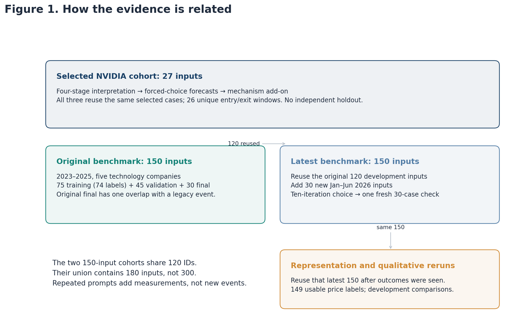
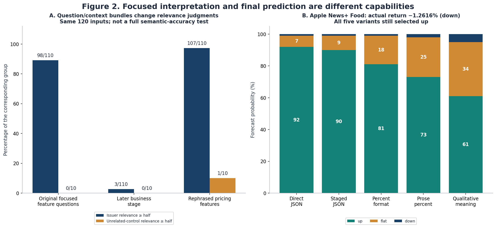
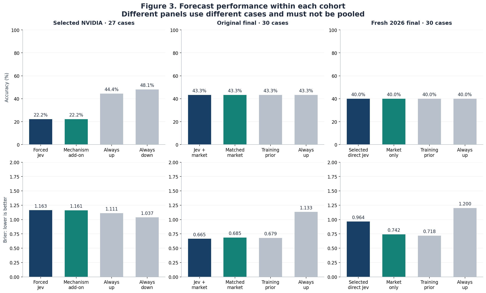
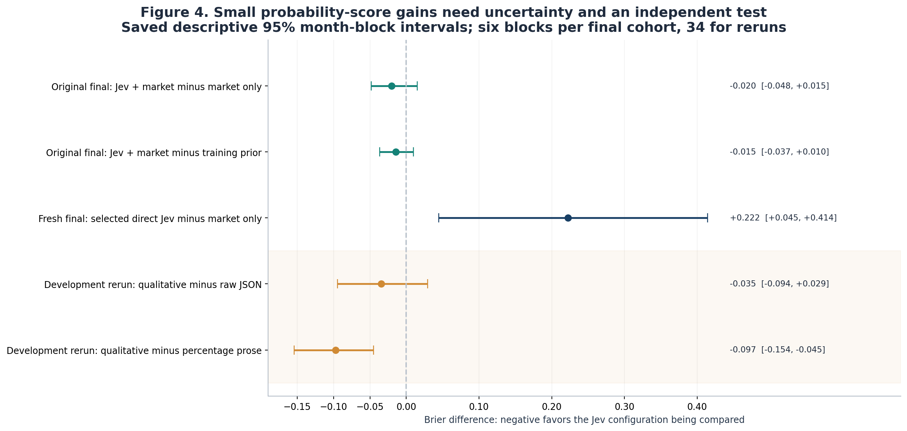
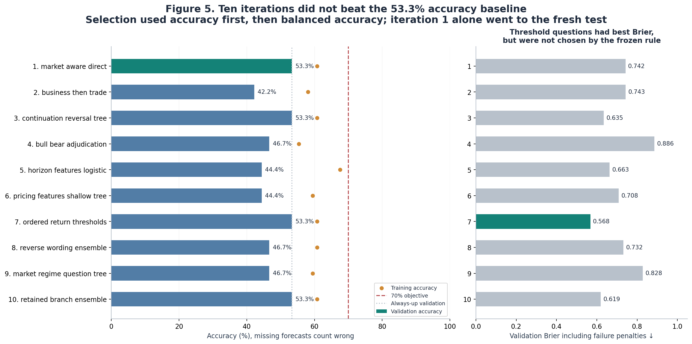
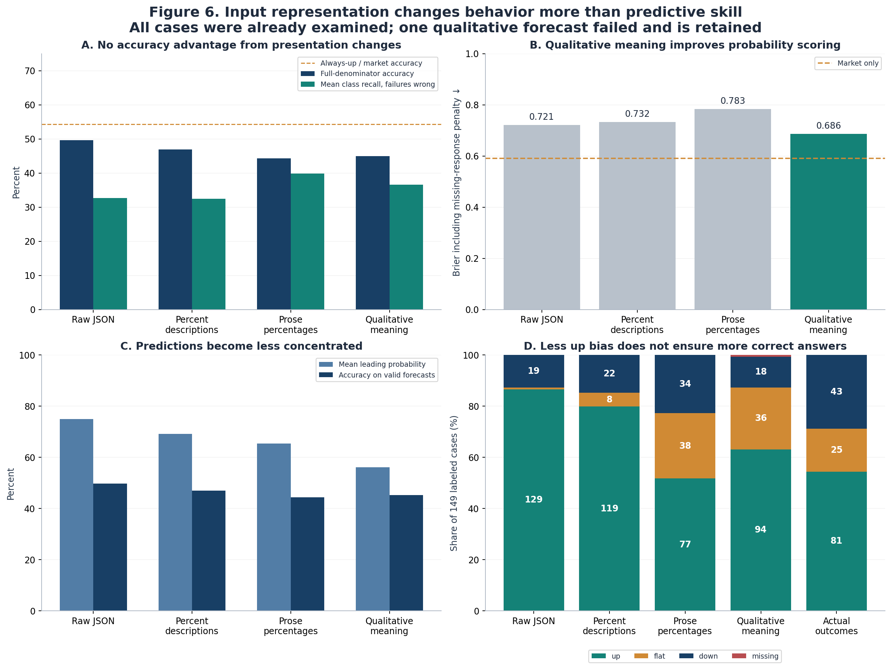

# What the Jev experiments demonstrate

**A study of the saved experiments in `jev_model_eval` and `jev_benchmark_lab`**  
Evidence reviewed through October 19, 2026. Tested model: **`jev-1.13.0`**. This study analyzes existing records; it makes no new Jev calls and does not tune against any final test.

**Jev demonstrated useful, sometimes quite sharp business interpretation, but these experiments did not establish reliable additional information about subsequent five-session stock returns.** Its best original Jev-plus-market model produced a small, uncertain probability-score improvement. The later ten-iteration search failed to reach 70% accuracy: its chosen strategy scored 40% on a fresh 30-case test, predicted up for every case, and assigned worse probabilities than the market-only reference.

The input-rewriting experiments found something narrower and useful. Explaining numbers in qualitative language made forecasts less concentrated and improved probability scoring against the preceding prose version. It did not make the directions more accurate than the original JSON reference or the baselines. Better uncertainty expression and better predictive information are different achievements.

These conclusions describe the tested model, inputs and orchestration. The evidence is too narrow to rate every Jev capability, every model version or every possible financial task. The most informative assessment separates **reading business evidence**, **mapping that evidence to returns**, and **expressing uncertainty reliably**.

## 1. What was actually tested, and what the scores mean

The repository contains several experiments, but fewer independent events than the number of model calls suggests. The original 27 NVIDIA cases were reused for forced-choice prediction and the market-mechanism add-on. A later benchmark introduced 150 inputs. The ten-iteration search then kept its 120 development inputs and added a new 30-case final period. The representation experiments reused that latest set after its outcomes had been examined.



*Figure 1. Repeated strategies are repeated measurements of the same inputs. The two 150-input benchmarks share 120 IDs; together they contain 180 distinct benchmark input IDs, not 300 independent events.*

| Evidence group | Composition and use | What it can establish |
|---|---|---|
| Original NVIDIA interpretation, forced forecasts and mechanism add-on | Same 27 selected cases; 26 distinct entry/exit windows | Concrete behavior and failure examples; no independent generalization estimate |
| Original benchmark | 75 training inputs, 45 validation inputs, 30 July-December 2025 final inputs | A small chronological comparison, with an identified legacy-overlap limitation |
| Ten-iteration search | Same 120 development inputs; 30 new January-June 2026 final inputs | One fresh check of the configuration selected during the search |
| Representation and qualitative reruns | Latest 150 inputs, including the now-exposed 2026 final period | Paired development comparisons of behavior and scores |

The original and later benchmarks cover **NVDA, AAPL, AMD, META and MSFT**. Each 150-input set contains 135 issuer items and 15 unrelated NASA astronomy controls. Accessible company newsrooms supplied the business texts. The original selection used publication dates, seeded sampling and text-side categories, including adverse-action and financial-results strata, before examining returns. Its saved report records 302 selection exclusions: 301 previously inspected sources or nearby legacy NVIDIA events, and one page without a substantive article-body selector.

The original NVIDIA inputs differ in provenance: they are selected source-based factual paraphrases, not archived full articles. Their shared company profile uses a February 2020 baseline across events from later years. That stale common context limits assessments of company scale, even when the event facts themselves are clear. The benchmark instead supplies explicitly labeled publisher excerpts and minimal company descriptions; neither design supplies a complete contemporaneous valuation or expectations record.

This is a constrained research sample. Company newsrooms favor announcements the issuer wants to publicize, and astronomy texts are easy negative controls. A few large technology companies, product announcements and corporate press releases do not represent the range of financial reporting, conflicting journalism, fraud allegations or obscure companies. The selected NVIDIA examples are particularly useful for diagnosis, but their anticipated favorable/adverse interpretations are case-design hypotheses, not independently adjudicated semantic answers.

**The prediction target is specific.** The evaluator buys conceptually at the first regular-session opening price strictly after the decision cutoff and measures the return to the fifth session's closing price, counting entry as session one. Up means above +1%; flat includes both -1% and +1%; down means below -1%. In the benchmark, the cutoff is 23:59:59 New York time on the displayed publication date.

The calculation is `exit_close / entry_open - 1`. Archived Yahoo/yfinance OHLC are used with `auto_adjust=False`, `actions=True` and `repair=False`; the protocol treats vendor OHLC as split-adjusted and excludes cash dividends. The XNYS calendar handles regular sessions, holidays and early closes. Missing or invalid prices are not interpolated. A reported corporate split inside the target window makes the label unscorable without replacing the case.

That last rule affects one input, `NVDA-2024-06-03-2781994dfb`. Thus 150 selected inputs yield **149 usable return labels**. This is a *stock-split* exclusion, not a case removed because its chronological training window crossed validation. In the original benchmark, the usable training/validation/final label counts are 74/45/30. The later cohort has the same 74 training and 45 validation labels plus 30 fresh final labels.

The target deliberately excludes much of an announcement's immediate overnight reaction. A model can correctly recognize harmful news and still miss this later return. Conversely, a correct return forecast does not prove that the model understood the announcement's causal effect. The experiment measures neither a causal news response nor a trading strategy after costs, spreads and implementation constraints.

**Training, validation and final evaluation have separate jobs.** The small external statistical models learn their coefficients or tree rules from the training period. Validation selects prompts, features and parameters. A final period checks the frozen selection on cases excluded from that selection process. Jev's own weights were never trained here. The agent modified questions and orchestration, and sometimes fitted a separate small model using Jev's outputs.

The original training dates are January 2023 through June 2024; validation is July 2024 through June 2025. The original final period is July-December 2025, replaced by January-June 2026 for the later search's new final check. Cases remain in their frozen periods; the representation reruns do not create new training or test assignments.

The original benchmark selected by probability score. The later search, following the 70% accuracy objective, used accuracy first, balanced accuracy second and failure-penalized Brier third. This change matters: a strategy with the best probability score was not necessarily the later search winner.

**Brier evaluates the whole probability forecast.** For each case, the observed class becomes a vector such as `(0, 0, 1)` for down. The evaluator sums the squared differences between that vector and the three forecast probabilities, then averages across cases:

```text
Brier = mean[(p_up - y_up)^2 + (p_flat - y_flat)^2 + (p_down - y_down)^2]
```

The convention here ranges from 0 to 2, with lower better. If down occurs, `(0.90, 0.09, 0.01)` loses 1.7982, whereas `(0.61, 0.34, 0.05)` loses 1.3902. Both still choose the wrong direction. This explains why softer probabilities can improve Brier without increasing accuracy. Brier rewards useful discrimination as well as appropriate probability assignment; it is not a pure measure of calibration alone.

Accuracy counts correct top choices. Balanced accuracy averages the recall of up, flat and down, giving the minority classes equal weight. Always-up therefore has balanced accuracy 33.3% whenever all three actual classes are represented, even if an up-heavy sample gives it ordinary accuracy above 50%.

Coverage requires explicit denominators. **API-response coverage** asks whether a schema-valid answer returned; **forecast coverage** asks whether a valid up/flat/down distribution was available. The original abstention-capable run returned answers on all 27 cases but made no directional decisions. Later tables use forecast coverage for their required three-class forecasts. **Label coverage** asks whether a usable price outcome exists, while **decision coverage** asks how many forecasts a separate abstention policy accepts. A 70% success rate on a small accepted subset is not 70% accuracy across all cases.

This study keeps failures visible. For full-denominator accuracy, a failed forecast with a valid label counts wrong. For comparable Brier summaries, it uses the archived worst-case loss of 2 for that failure. Where a saved balanced-accuracy field excludes missing forecasts, the tables below instead count the missing prediction wrong in its actual class. These are transparent analytical summaries; the archived evaluator and results have not been changed.

There are also limits to independence. The original 150 include two different June 15, 2023 Apple inputs, one NASA control and one Battersea-opening announcement, with the exact same target return window. Four other same-stock pairs partly overlap within their splits. No usable target sessions overlap across the original chronological splits, but **one original-final NASA control overlaps four sessions of the previously inspected H20-license case**. The later fresh 30 were checked against previous same-stock windows and have no such overlap. Cross-company market shocks can still make their outcomes dependent.

Finally, the historical texts were collected during the experiment, not captured at publication. Every historical version is marked uncertain, and source excerpts are explicitly identified. A historical date does not prove the current text existed then. Nor can a historical holdout remove facts already present in Jev's training. Even the fresh final periods here supply **retrospective evidence**, not prospective deployment evidence. The detailed rules and source metadata are in the [original frozen protocol](jev_benchmark_lab/frozen/protocol.json) and [verification record](jev_benchmark_lab/records/verification.json).

## 2. Business understanding: real strengths, unstable judgments and accounting limits

The strongest evidence for Jev is at the level of bounded interpretation. It can recognize a clearly stated improvement, deterioration or conditional business mechanism. The original NVIDIA cases contradict the idea that it simply chooses one business answer regardless of content.

Consider two results announcements. In the [2023 AI outlook case](jev_model_eval/qualitative_news_tests_2026-10-17/01_nvda-results-2023-ai-outlook.json), the supplied text reports current revenue of $7.192 billion and company guidance of $11 billion for the next quarter. Jev assigned 82% probability to favorable revenue implications. In the [2022 gaming warning](jev_model_eval/qualitative_news_tests_2026-10-17/02_nvda-results-2022-gaming-warning.json), preliminary revenue of $6.70 billion falls below the company's prior $8.10 billion guidance, gaming drops 44% sequentially, and the gross-margin outlook deteriorates sharply. Jev assigned 93% to adverse revenue and 94% to adverse margin implications.

These are sensible readings of the supplied evidence. The comparison is against the company's own earlier guidance, not an invented analyst consensus. Jev also recognized the [April 2025 H20 restriction](jev_model_eval/qualitative_news_tests_2026-10-17/19_nvda-policy-h20-restriction-2025-04-15.json) as adverse to revenue and margin, assigning 99% to each. The source described new license requirements and an up-to-$5.5-billion charge.

The revenue judgments are more directly supported than the margin judgments. The stage asks about operating margin, while the gaming-warning source directly reports gross margin. Adverse operating-margin implications are plausible, but the figures do not directly establish them. Conversely, an unknown operating-margin answer to a source reporting only gross margin should not automatically count as a mistake.

It could also retain some distinction between good news and completed action. In the [July H20-license assurance case](jev_model_eval/qualitative_news_tests_2026-10-17/20_nvda-policy-h20-license-assurance-2025-07-14.json), revenue implications were favorable at 92%, but event status remained mainly proposed/agreed rather than completed. In the [IEEE honor case](jev_model_eval/qualitative_news_tests_2026-10-17/27_nvda-other-20260129-ieee-honor.json), company connection was high at 0.83, while the economic-event score was only 0.19. Being about the CEO was not automatically treated as a material operating development.

These examples support a capacity for local business interpretation. They do not establish a semantic accuracy percentage for all intermediate answers: the repository lacks independently annotated entity, accounting, causality and materiality labels for the full benchmark.

**The matched prompting comparison reveals a major reliability problem.** On the same 120 development inputs, the original focused feature questions assigned relevance of at least 0.5 to 98 of 110 issuer articles and none of 10 NASA controls. The later business-then-trade formulation assigned that level of relevance to only 3 of those 110 issuer articles. Another pricing-feature formulation assigned it to 107 issuer articles, but also raised control relevance substantially.



*Figure 2. Left: identical input IDs, different question/context bundles. Right: five forecasts for one Apple announcement, all choosing up despite an eventual down label. The panels measure different capabilities and do not constitute a semantic gold-standard test.*

On those matched 120 inputs, the original extraction chose favorable revenue 52 times, adverse once, mixed four times and unknown 63 times. The later business stage chose positive revenue twice and unknown 118 times. This is a large change toward pervasive uncertainty, not a measured semantic-accuracy decline: independent reference labels are missing. It cannot be described as a permanent inability of Jev to recognize favorable developments, because the earlier questions often elicited that recognition on the same sources.

The later business questions repeatedly include instructions about raw stock returns, the narrow flat band and the market reference. That mixes the task of identifying a business implication with the harder task of predicting a return. It is a plausible design weakness. But context, wording and options changed together, so these observations do not isolate one sentence as the cause. Similarly, increasing issuer relevance to 107/110 is not automatically an improvement: the mean control relevance rose to about 0.47, suggesting reduced selectivity.

**Frequent unknowns need interpretation.** Surprise was unknown on all 120 matched inputs under both original and later prompts. Most inputs did not supply analyst consensus or contemporaneous investor expectations, so that answer often respects the evidence. Missing cash-flow direction may also be appropriate for a product announcement without cost, volume or collection information. Unknown is not an error merely because it is common, and unknown is not the same as a flat future return.

Other cases show a less defensible tendency to infer spending or damage from amounts that do not establish it. In the [US manufacturing case](jev_model_eval/qualitative_news_tests_2026-10-17/13_nvda-operations-2025-us-manufacturing.json), an up-to-$500-billion, four-year partner-production initiative was followed by a 79% adverse investment/cash judgment. The source does not establish that the entire figure is NVIDIA's own incremental capital spending. The distinction involves who pays, what the amount measures and when spending occurs, not just reading the digits.

The [Blackwell yield case](jev_model_eval/qualitative_news_tests_2026-10-17/14_nvda-operations-2024-blackwell-yield.json) gives reasons for gross-margin pressure, and Jev assigned adverse operating margin 93%. Again, that is a plausible extension rather than a directly observed operating-margin result. Its adverse investment/cash judgment of 81% is less securely supported. Inventory provisions do not automatically establish a new cash outflow; outstanding purchase and capacity obligations do not by themselves specify incremental spending during the forecast window. The output shows evidential overreach, although it does not reveal the model's hidden reasoning.

A particularly clear later example is **AMD's May 14, 2025 $6-billion buyback authorization**, case `AMD-2025-05-14-16218f4052`. The source explicitly says the program does not obligate AMD to acquire shares and that timing depends on conditions. The business-then-trade stage gave negative free cash flow 55%. An authorization can permit future cash use; it does not establish executed purchases. The [saved source input](jev_benchmark_lab/question_search_10/data/development_cases.json) and [stage record](jev_benchmark_lab/question_search_10/records/iteration_02_records.json) make the mismatch inspectable without using the stock's later return as an accounting answer.

Narrower questions sometimes helped. The mechanism add-on classified the CEO's personal sales as an existing-holder sale with 99%, a useful distinction from company issuance. For NVIDIA's Dow inclusion it identified conditional index-tracking buying at 99%, while assigning only 0.09 support to remaining flow and 0.05 to its size. This is a meaningful separation between **a plausible mechanism** and **evidence that the mechanism still has measurable force**. The final forecast did not always respect that separation.

The capability assessment is therefore mixed: clear directional operating changes can be read well, but relevance is highly sensitive to formulation, accounting boundaries are not consistently respected, and additional stages do not reliably preserve the quality of the earlier interpretation. Structured answers make these problems visible; they do not prevent them.

## 3. Return prediction: why the strongest tests do not establish added value

In the original four-stage NVIDIA run, all 27 forecasts chose insufficient evidence. That is not evidence of successful direction prediction, but it is also not the same result as 27 missing API responses. The system returned valid answers while making no directional decisions. Removing the abstention option exposed what happened when it had to assign a return class.

The [forced-choice evaluation](jev_model_eval/forced_choice_forecasts_2026-10-18/evaluation.json) scored **6/27, or 22.2% accuracy**, with balanced accuracy 16.0% and Brier 1.1632. Always-up scored 44.4%, and always-down 48.1%. The model was not simply choosing up in this small cohort: it predicted up 11 times, flat seven times and down nine times. The poor result combines class selection errors and excessive certainty.

The gaming warning is the clearest example of why business sentiment does not determine this target. Jev correctly recognized adverse operating evidence, then assigned **100% probability to down**. Yet the saved return from the August 9 opening to the August 15 closing was **+10.3176%**. The record establishes the mismatch. It does not establish whether valuation, prior positioning, other news or market movement caused the rebound; claiming it was definitively "already priced in" would add an explanation absent from the test.

Other high-confidence misses were similarly informative. The H20-license assurance received 96% up but returned +0.1110%, inside flat. AMD's MI300X competitive announcement received 94% down for NVIDIA but the target return was +5.2254%. The personal-share-sale case received 95% flat but returned -3.8508%. An announcement with no established operating effect does not imply that a volatile stock will remain within a narrow price band.

Ten forecasts in this cohort assigned at least 90% to their leading class; only three were correct. High output probability was not a reliable signal that the prediction was right. This is a descriptive observation on selected familiar cases, rather than a calibrated prospective reliability estimate.



*Figure 3. Compare bars within a panel. Different panels contain different cases. Equal accuracy can coexist with very different probability quality; neither final-test panel shows a directional advantage from the chosen Jev configuration.*

**The market-mechanism add-on did not fix the mapping.** It scored 6/27 again, with Brier 1.1610 versus 1.1650 for its fresh identical-input control. Three classifications changed: one wrong answer became right, one right became wrong and one remained wrong. The fresh control itself changed one class relative to the earlier archived forecast, so tiny differences cannot all be attributed to the intervention.

The Dow case illustrates both promise and overreach. Jev identified conditional index buying while acknowledging little evidence about remaining size, yet the add-on shifted up probability from 35% to 67%. The subsequent +7.5942% return made this a successful change. In the Fed-cut case, however, an up forecast became flat and missed a +5.2493% return. A good-looking mechanism story did not produce a net accuracy gain. The [add-on summary](jev_model_eval/experimental_market_mechanism_addon_2026-10-18/summary.json) preserves both directions of change.

**The original benchmark's best result was a small probability improvement.** Four strategy changes moved from the legacy pipeline toward simpler prediction, probability shrinkage and externally fitted models. The validation results explain why a regularized statistical wrapper became the best Jev-containing method:

| Original strategy/reference | Validation accuracy | Validation Brier | Interpretation |
|---|---:|---:|---|
| Legacy four-stage Jev | 15.6% | 1.3210 | Interpretation stages did not supply a reliable return mapping |
| Single direct Jev call | 26.7% | 1.2596 | Simpler orchestration helped, but remained weak |
| Direct probabilities blended 50/50 with training frequencies | 28.9% | 0.7717 | Reducing extreme probabilities helped substantially |
| Market + Jev logistic, C=0.1 | 48.9% | 0.6698 | Learned mapping improved on direct prompting |
| Matched market-only logistic, C=0.1 | 51.1% | 0.6398 | Jev features did not improve this comparison |
| Market + Jev logistic, C=0.01 | 53.3% | **0.5892** | Stronger regularization selected by validation Brier |
| Matched market-only logistic, C=0.01 | 53.3% | 0.5929 | Nearly the same validation score without text features |
| Training-frequency probabilities | 53.3% | 0.6038 | An important low-complexity reference |

The external logistic model converts features into three probabilities. It fits an additive score per class and transforms the scores into a distribution. Regularization discourages large coefficients when the small training set cannot support them; `C=0.01` shrinks more strongly than `C=0.1`. This is a small supervised model trained on 74 usable examples, not an update to Jev.

Its ten market features summarize pre-cutoff stock/SPY returns over 1, 5 and 20 sessions, recent volatility and relative movement. Fourteen Jev features summarize relevance, economic-event and incremental-support judgments, favorable-minus-adverse and unknown probabilities for five channels, and missingness. The matched market-only model uses the same learning method without those Jev features. That comparison asks whether text judgments add information beyond price history, rather than merely whether a learned model beats an overconfident direct forecast.

On the original final 30, the selected Jev-plus-market model scored **43.3% accuracy and Brier 0.6648**. The matched market model scored **43.3% and 0.6852**; training frequencies scored **43.3% and 0.6795**. All three chose up for every case. The Jev features changed probabilities, not the directional choices.

The paired Brier advantage over market-only was 0.0204, but the saved descriptive 95% month-block interval for selected minus market was **[-0.0484, +0.0149]**. It crosses zero. There were only six month blocks, and one final case had the legacy-window overlap described earlier. This is tentative incremental evidence worth retaining, not a demonstrated forecasting advantage.

**The later fresh final test was less favorable.** After ten strategy iterations, the frozen selected direct Jev method achieved **12/30, or 40.0%**, on the new January-June 2026 period. The actual classes were 12 up, seven flat and 11 down. Every selected prediction was up. Balanced accuracy was 33.3%.

| Fresh 2026 final method | Accuracy | Brier | Directional behavior |
|---|---:|---:|---|
| Selected direct Jev strategy | 40.0% | **0.9643** | All 30 up |
| Frozen market-only model | 40.0% | 0.7420 | All 30 up |
| Earlier frozen Jev-plus-market model | 40.0% | 0.7556 | All 30 up |
| Training-frequency probabilities | 40.0% | **0.7182** | All 30 up |
| Always-up with probability 1 | 40.0% | 1.2000 | All 30 up |

Jev beat the overly certain always-up probabilities, but not the meaningful probabilistic baselines. Against market-only, its Brier was worse by 0.2223; the saved month-block interval was [+0.0449, +0.4141]. The uncertainty is substantial, but it does not support an advantage for the selected Jev strategy. A simple independent-case Wilson interval for 12/30 is approximately 24.6%-57.7%; shared market conditions make that independence assumption optimistic.



*Figure 4. Negative differences favor the named Jev configuration. These are saved descriptive month-block intervals, not a correction for repeated prompt selection or a guarantee about future markets. The shaded comparisons reuse familiar development cases.*

The [original final results](jev_benchmark_lab/records/final_results.json), [original paired uncertainty](jev_benchmark_lab/records/paired_uncertainty.json), [fresh final results](jev_benchmark_lab/question_search_10/records/final.json) and [fresh uncertainty](jev_benchmark_lab/question_search_10/records/uncertainty.json) support these separate conclusions. They should not be pooled into a single overall "Jev accuracy": the cohorts, learning methods and selection procedures differ.

## 4. What ten iterations and input rewriting actually changed

The agentic loop proposed a change, stated an expected benefit, ran training/validation comparisons and retained or rejected it. It was similar to reinforcement learning only in the broad sense of using measured feedback to revise a strategy. There was no reinforcement-learning update to Jev's weights. Repeatedly consulting one 45-case validation set also creates selection risk: an apparently better prompt may be adapting to those particular examples.

The search explored direct prediction, staged business judgments, continuation/reversal branches, bull/bear comparisons, small learned models, cumulative return thresholds, reversed wording, market-regime branches and ensembling. More elaborate orchestration did not steadily improve results.



*Figure 5. No iteration exceeded the always-up validation accuracy of 53.3%. Iteration 1 won the frozen accuracy-first ranking; iteration 7 had the best Brier. Missing forecasts count wrong, and Brier includes the declared failure penalty.*

| Iteration | Strategy | Validation correct / 45 | Balanced accuracy, failures wrong | Failure-penalized Brier | Forecast coverage |
|---:|---|---:|---:|---:|---:|
| 1 | Market-aware direct | 24 | 34.2% | 0.7422 | 100% |
| 2 | Business then trade | 19 | 28.1% | 0.7427 | 100% |
| 3 | Continuation/reversal tree | 24 | 33.3% | 0.6350 | 100% |
| 4 | Bull/bear adjudication | 21 | 33.3% | 0.8857 | 97.8% |
| 5 | Horizon features + logistic regression | 20 | 36.9% | 0.6633 | 100% |
| 6 | Pricing features + shallow tree | 20 | 42.8% | 0.7082 | 100% |
| 7 | Ordered return thresholds | 24 | 33.3% | **0.5678** | 100% |
| 8 | Reverse wording + ensemble | 21 | 30.8% | 0.7315 | 100% |
| 9 | Market-regime question tree | 21 | 30.8% | 0.8279 | 100% |
| 10 | Ensemble of retained branches | 24 | 33.3% | 0.6193 | 100% |

The selection detail is revealing. Iteration 1 correctly predicted one down case that always-up missed, but incorrectly changed one up case to down. It still had 24 correct answers. Its slightly higher balanced accuracy won the tie-break; this was a one-case trade, not broad competence across classes. On the fresh final period it reverted to all-up decisions.

Iteration 7 asked two cumulative questions: the probability of a return below -1%, and the probability of a return at most +1%. Code converted those into down, flat and up probabilities, using a declared reconciliation if their order conflicted. This interface produced validation Brier **0.5678**, better than the strong fixed market reference's 0.5929, while still choosing up on all 45 cases. That is an interesting probability-interface result. It was not selected by the accuracy-first rule and has no fresh final evaluation; retrospectively declaring it the winner would change the decision rule after seeing results.

Its often-cited **71.4% accuracy** was 10 correct among 14 predictions accepted at a 60% probability threshold. That is only **31.1% decision coverage**, on the reused validation set. It does not meet the 70% full-coverage objective. The chosen method's own fresh-final accepted subset scored only 10/26, or 38.5%, at 86.7% coverage. High reported probabilities did not create a consistently useful abstention policy.

There were limited positive feature comparisons. Iteration 5's logistic model improved from 35.6% to 44.4% validation accuracy and from Brier 0.6986 to 0.6633 when Jev features were added to its matched learner. Iteration 6's shallow tree kept accuracy at 44.4% but improved Brier from 0.8001 to 0.7082 and balanced accuracy from 36.1% to 42.8%. These results should not disappear from a failure report. However, both remained below the stronger fixed baselines on accuracy, and neither was independently checked on the fresh final set. Comparing iteration 5 directly with iteration 6 also confounds the learner and feature-wording changes.

**Rewriting the same evidence changed output behavior substantially.** The representation trials compared raw nested JSON, percentages with descriptions, extractive prose containing percentages, and a later qualitative-meaning version. The prose source passages were selected actual source sentences, not a new Jev-generated article summary. The qualitative layer added deterministic descriptions of numerical meaning, while retaining source financial facts and the literal return target.

For example, stock and market movements could be described as conflicting historical directional signals. Movement strength was classified relative to a predeclared volatility scale. Earlier business-answer probabilities became words describing strength of support, with unknown explicitly treated as an evidence gap. These transformations were defined in code, not inferred from future outcomes. Their thresholds are explanatory conventions, not established statistical-significance tests.

| Latest 150-input representation | Correct / 149 labels | Full accuracy | Balanced accuracy, failures wrong | Failure-penalized Brier | Forecast coverage |
|---|---:|---:|---:|---:|---:|
| Raw JSON, two stages | 74 | 49.7% | 32.6% | 0.7207 | 100% |
| Percentages + descriptions | 70 | 47.0% | 32.5% | 0.7324 | 100% |
| Extractive prose + percentages | 66 | 44.3% | 39.8% | 0.7832 | 100% |
| Qualitative meaning | 67 | 45.0% | 36.6% | **0.6861** | 99.3% |
| Frozen market-only reference | 81 | 54.4% | 33.3% | **0.5910** | 100% |
| Training-frequency probabilities | 81 | 54.4% | 33.3% | 0.6007 | 100% |

All these outcomes were already available during this development comparison. The aggregate references also include the 74 cases used to fit their statistical models. Consequently, 54.4% here is not a new out-of-sample performance claim, and the representation trials do not restore an independent holdout by retaining historical split names.



*Figure 6. On the same labeled inputs, prose reduced the up default and qualitative meaning softened probabilities. Neither produced an accuracy advantage over the raw reference or fixed baselines. The confidence comparison uses the largest class probability, not the API's separate confidence field.*

The raw version predicted up on 129 of 149 labeled cases, compared with 81 actual up outcomes. Prose reduced up predictions to 77 and made more flat/down calls, but created 24 new errors while correcting only 16 of the raw version's mistakes. Changing the class distribution toward a more varied answer set is not enough; the changes must occur on the right cases.

Qualitative meaning corrected 15 prose mistakes and introduced 14 new errors. That is a one-case net accuracy gain, with a saved month-block accuracy interval spanning negative and positive changes. Its Brier improvement over prose was more substantial: **-0.0971**, with a descriptive interval [-0.1542, -0.0451]. Against raw JSON, however, its Brier advantage was only -0.0346, with interval [-0.0944, +0.0295], while its accuracy was lower by 4.7 percentage points.

The improvement is consistent with softer probabilities. Mean leading probability fell from 74.9% for raw JSON to 69.1% for described percentages, 65.4% for percentage prose and 56.1% for qualitative meaning. The respective observed accuracies among valid labeled forecasts were 49.7%, 47.0%, 44.3% and 45.3%. The qualitative arm's full-denominator accuracy is slightly lower, 45.0%, because one forecast failed. These aggregate gaps suggest excessive confidence, but they are not a full reliability curve. The raw version's 30 forecasts at 90% or higher were correct only 15 times, despite a mean leading probability of 92.2%.

The failed qualitative case was NVIDIA's August 23, 2023 input. Its first stage exhausted three attempts with invalid probability sums; it was preserved rather than replaced. The saved covered Brier is 0.6772 on 148 labeled forecasts, whereas the failure-penalized comparison is 0.6861 on all 149 labels. Using the smaller covered score without disclosing the missing case would overstate performance.

**A complete Apple example shows what changed and what did not.** Case `AAPL-2025-02-21-216bbb1456` announces Apple News+ Food, a recipe feature launching in April. The source establishes a connection to Apple's service but supplies no quantified incremental revenue or analyst-consensus surprise. Before the cutoff, Apple had risen 9.79% over 20 sessions while SPY had fallen 1.61%. The frozen market model assigned up/flat/down probabilities of **65.17% / 13.22% / 21.61%**.

Under the original focused extraction, relevance was 0.86 and favorable revenue probability 0.67, with low support for a quantified increment. The later raw business stage gave relevance 0.31 and revenue unknown 0.81; cash and surprise were also unknown. Yet the final raw staged forecast was **90% up, 9% flat, 1% down**. The state passed to that final stage retained the questions and earlier answer distributions. Missing stage context does not explain this example.

The percentage version produced 81/18/1; percentage prose 73/25/2; qualitative meaning 61/34/5. A single direct call, without the intermediate stage, had already produced 92/7/1. Thus staging was not necessary for this upward result. The qualitative rewrite moderated certainty, but all variants chose up and left little probability on down.

The actual entry was February 24 at 244.92999, and the fifth-session exit was February 28 at 241.84000: **-1.2616%, down**. This one case does not prove general anchoring or random behavior. It does show uncertain business evidence followed by a much more concentrated up forecast than the supplied market reference, and a later rewrite that softened rather than corrected the direction. Both the [representation trace](jev_benchmark_lab/question_search_10/representation_example_AAPL-2025-02-21-216bbb1456_full_trace.md) and [qualitative trace](jev_benchmark_lab/question_search_10/qualitative_example_apple_full_trace.md) preserve complete inputs and outputs.

**The context-length and numeracy hypotheses remain unresolved.** Mean forecast-stage input fell from about 4,780 tokens in raw JSON to 1,977 in percentage prose, a reduction of roughly 59%. Accuracy and Brier became worse. The qualitative version averaged about 1,888 tokens, improved Brier relative to prose, and still failed to improve accuracy relative to raw JSON. Adding percentage descriptions actually lengthened the mean forecast input to about 5,217 tokens.

Those results do not support "shorter context solves it." They also do not prove length never matters. Layout, selected sentences, numeric rendering and interpretation changed together; no isolated short-versus-long or exact-number-versus-word experiment held everything else fixed. Similarly, all 27 original magnitude stages judged company-scale support below 0.5, but missing comparable periods, units or incrementality can justify that result. This was not a controlled arithmetic exam.

The provider's [version-specific jaggedness documentation](https://docs.typesafe.ai/model-jaggedness/jev-1.13) identifies weaknesses involving numerical precision, irrelevant context, literal interpretation and question framing. That makes the hypotheses plausible, not established causes of these outcomes. The [model documentation](https://docs.typesafe.ai/models) lists a 64k request allowance and 32k question allowance for the tested 1.13 model; these inputs were well below those ceilings. Capacity limits and sensitivity to distracting information are different issues. No result here evaluates newer Jev versions.

## 5. The capability boundary, and what would make a stronger claim credible

**As a reader of narrowly specified business evidence, Jev has demonstrated useful capabilities but inconsistent reliability.** It recognized clear guidance deterioration, export restrictions, favorable outlooks and some conditional market mechanisms. It could distinguish personal share sales from company issuance when the question made that boundary concrete. Those are meaningful abilities for structured extraction and screening.

The weaknesses are equally concrete. Relevance collapsed under a later prompt bundle despite being handled much better by earlier focused questions. Some cash-flow judgments exceeded what authorizations, provisions or partner-investment totals established. Intermediate answers were not comprehensively annotated by independent reviewers, so the appropriate description is "promising but prompt-sensitive interpretation," not a validated semantic accuracy rating.

**As a five-session return forecaster, the tested systems have not earned a claim of incremental value.** The selected NVIDIA cases performed poorly when forced into directions. The original independent-period comparison offered a small uncertain probability gain without different class decisions. The later fresh test offered no directional improvement and materially worse probability scores. No full-coverage strategy reached 70%; the selective validation result above 70% covered fewer than one third of cases and did not establish generalization.

The record also does not justify saying Jev never added anything. The initial strongly regularized feature model, two matched development learners and the cumulative-threshold probability interface all produced limited positive comparisons. Qualitative explanations improved probability scoring relative to the previous prose representation. These findings deserve preservation as hypotheses for a new experiment, with their sample sizes, comparison methods and lack of fresh confirmation attached.

**Operational success is a separate capability.** The runs produced inspectable typed judgments, cached repeated requests and preserved rejected answers. The original benchmark recorded 876 unique cached requests and 887 attempts, with 11 rejected/error attempts. The ten-iteration search recorded 1,322 cached requests, 1,362 attempts, 41 rejected attempts and one exhausted request. The qualitative rerun recorded 299 requests, 311 attempts, 13 rejected attempts and one exhausted request. These figures are separate run inventories, not quantities to add into a count of independent research observations.

The frozen response policy requires complete typed answers, finite probabilities summing to one, a top-choice-consistent selected option and the concrete model version. Up to three identical attempts are allowed for format or transport failures; predictions are not retried because their direction looks wrong. This supports auditability. It does not make a valid response semantically correct or its probabilities empirically calibrated. Typed outputs also do not supply a faithful explanation of hidden reasoning: a question sequence is an observable computation structure, not proof of an internal reasoning process.

The most defensible role suggested by this work is therefore a **bounded evidence-processing component with explicit unknowns and external checks**. Entity, period, units, authorization-versus-execution and source support should be inspectable. Arithmetic and market-data calculations should remain deterministic. Whether those features are useful for forecasting must be tested against the same downstream model without them, rather than assumed because the intermediate answers sound plausible.

A stronger next study would first measure interpretation directly. Reviewers could label source relevance, affected entity, direction, accounting channel and whether magnitude is established, while blinded to returns. That would distinguish a failure to read the article from a failure to forecast a noisy market outcome. Paired prompts should hold source content, questions and model version fixed when isolating JSON layout, word explanations or context length.

For prediction, the decisive evidence would come from a new frozen, prospective batch. Save the input text, actual observation time, source hash, model version, question version and complete forecast before the next opening. Commit the predictions before outcomes exist, then compute the unchanged fifth-session labels once they mature. Keep all missing cases and report Brier, balanced accuracy and coverage against training priors and matched market-only models. Predetermine the sample size and analysis date; do not keep checking until a favorable headline appears.

That procedure cannot promise 70%. It can determine whether a future strategy adds useful information. The present experiments already support a clear finding: **the autonomous prompt-and-question optimization run failed to demonstrate robust return-prediction value, while revealing both useful local interpretation and substantial sensitivity in how that interpretation is elicited and converted into forecasts.**

## Evidence and reproduction

The figures are rebuilt exclusively from archived results. [JEV_STUDY_EVIDENCE.json](JEV_STUDY/JEV_STUDY_EVIDENCE.json) records their numerical inputs and SHA-256 hashes of the files the builder reads. [JEV_STUDY_BUILD.py](JEV_STUDY/JEV_STUDY_BUILD.py) contains the plotting and denominator calculations. It makes no network requests, fits no models and writes only the derived study artifacts. Python with NumPy and Matplotlib is sufficient.

From the repository root:

```powershell
python -B JEV_STUDY/JEV_STUDY_BUILD.py
```

For inspection without replacing the study figures, supply an existing output directory:

```powershell
python -B JEV_STUDY/JEV_STUDY_BUILD.py --output "$env:TEMP"
```

The main evidence trail is the [original interpretation overview](jev_model_eval/qualitative_news_tests_2026-10-17/overview.json), [forced forecasts](jev_model_eval/forced_choice_forecasts_2026-10-18/evaluation.json), [mechanism comparison](jev_model_eval/experimental_market_mechanism_addon_2026-10-18/summary.json), [initial benchmark report](jev_benchmark_lab/REPORT.md), [ten-iteration report](jev_benchmark_lab/question_search_10/REPORT.md), [representation scores](jev_benchmark_lab/question_search_10/records/representation_scores.json), [qualitative scores](jev_benchmark_lab/question_search_10/records/qualitative_scores.json) and [paired qualitative comparisons](jev_benchmark_lab/question_search_10/records/qualitative_paired_comparisons.json). Individual iteration proposals, retained/rejected decisions and raw responses remain in their original experiment records.

The final study stays at the repository root; its figures, evidence file and builder are in `JEV_STUDY/`. Existing scripts, case inputs, outcomes and experiment records remain unchanged. Saved closure audits passed at experiment completion; later authorized Markdown updates are separately recorded in the [documentation-update manifest](jev_benchmark_lab/question_search_10/records/documentation_update_2026-10-19.json). Older preservation snapshots were intentionally retained, so a literal rerun can flag those documented Markdown changes rather than changed experimental evidence.
