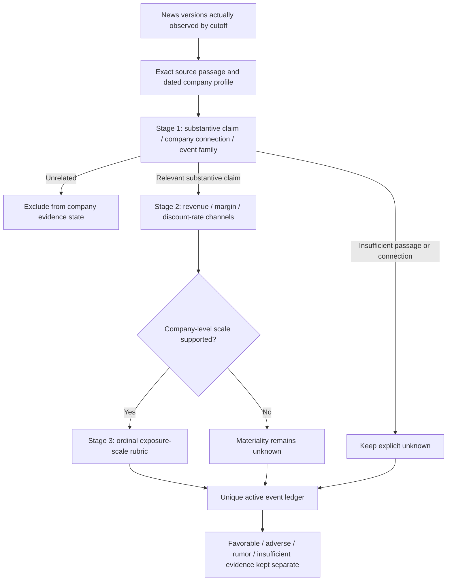

# Basic Jev news interpretation demo

The demo connects the existing immutable news archive to a small, staged Jev question graph. It evaluates conditional company economics and preserves the evidence for every decision. It does not estimate stock-return probabilities, a price target or trading performance.

## Start offline

From this standalone folder, run:

```powershell
python -m jev_news jev-demo
```

Open the `report.html` path printed by the command. Expand each event's stages to inspect the Noul, Choice and Score results. Each stage links to its input/questions and complete response distribution. The report also links to the frozen inputs and question registry.

**Every event, company exposure and model distribution in offline mode is invented.** NVIDIA is the named target in a synthetic scenario; none of the fixture stories report real events. `fixture` means hand-authored values, not cached actual Jev inference. The offline path uses no network or paid model.

The fixture is in `fixtures/jev-demo.json`. It contains eight documents describing six underlying events. The customer-budget announcement is repeated and later corrected. Those copies do not create three independent economic shocks.

## The decision graph



The registry version is `news-interpretation-0.1.0`. The registry and its hash are saved with every run.

1. **Stage 1: evidence and routing.** Noul asks whether an exact source passage asserts a substantive economic change. Choice classifies the primary company connection and event family. This tests what the text asserts, not whether the assertion is true.
2. **Stage 2: economic channels.** A new API call receives the original evidence and Stage 1 answers. Separate Choice questions assess revenue, operating margin and discount-rate effects. The options distinguish favorable, adverse, mixed, explicitly unchanged and unknown. A Noul question checks whether company-level scale is sufficiently quantified.
3. **Stage 3: exposure scale.** When the scale gate passes, another call receives both earlier stages. Score uses an ordinal rubric for the affected company exposure: under 1%, 1–5%, 5–10%, or at least 10% of the specified company measure. Its weighted index is not a percentage return or a guaranteed financial loss.

Questions within one call independently read the same state. Later stages use separate calls to establish dependencies, following the [official Jev API](https://docs.typesafe.ai/api).

The 0.65 routing/scale gates are demonstration settings, not calibrated thresholds. A raw Jev probability or confidence does not establish predictive accuracy. A single primary claim per event is assumed; compound news needs claim splitting in a later version.

## What the example demonstrates

| Case | Expected scripted behavior |
| --- | --- |
| Customer AI infrastructure budget | Indirect route through the supplied customer exposure; favorable revenue opportunity, amount of NVIDIA sales unknown |
| Correction from USD 24bn to USD 21bn against a USD 20bn prior plan | Code checks the exact quoted numbers; increase changes from 20% to 5%; older documents are superseded |
| Export restriction on a fictional product/geography | Direct company route; adverse conditional revenue channel; exposure-scale assessment uses the synthetic 12% exposure |
| Unverified packaging interruption | Conditional adverse channel, kept in a separate rumor list |
| Vague capacity-update headline | Insufficient evidence; missing detail is not zero impact |
| Local park story | Unrelated |
| 8-K index entry without filing text | Insufficient evidence; no invented filing content |

The combined report keeps favorable and adverse events separate. It does not add event probabilities or ordinal scores. Unknown inputs and rumor counts remain visible. Automatic semantic clustering is not implemented: the rich fixture supplies event/revision/lineage IDs explicitly; other archives use document identity and may still contain multiple publishers covering one event.

The baseline comparison is a **prior issuer plan**, not market consensus. A 5% budget increase is neither a 5% NVIDIA revenue increase nor an expected stock return. No conversion is supplied.

## Replay the correction

```powershell
python -m jev_news jev-demo --as-of "2026-10-10T12:20:00Z"
python -m jev_news jev-demo --as-of "2026-10-10T12:40:00Z"
```

The earlier report uses the USD 24bn announcement and its duplicate. The later report uses the USD 21bn correction. Each run gets a fresh directory; earlier reports are preserved. Cutoffs describe the synthetic input clock, not the actual time the model completed inference. This retrospective demonstration is not a prospective stock-market test.

## Use actual Jev inference

Set `TYPESAFE_API_KEY` securely in your local environment, then run:

```powershell
python -m jev_news jev-demo --backend live --max-calls 20
```

This sends the same **synthetic** evidence and profile to the actual API. It performs paid inference and records real model distributions in a new report. It does not fetch live news. The key is sent only in the Authorization header and is not written into report files. Do not put credentials in news text or profile files, because those inputs are intentionally archived.

The adapter pins `jev-1.13.0` at `https://api.typesafe.ai/v1/systemone`, based on the [official model documentation](https://docs.typesafe.ai/models) checked October 10, 2026. It validates response model, question IDs/types, complete normalized distributions, Choice selections, Score rubric/mean and token usage. The default attempt budget is 30; there are no automatic retries. A timeout can occur after a paid evaluation, so failures stop explicitly with a failed run report and no scripted fallback. Provider responses that fail adapter validation are not represented as successful results.

No local Jev credential was available during the original October 10 development checks. Actual inference has since been run in a separate October 12 historical pilot: see [HISTORICAL_PILOT_REPORT.md](HISTORICAL_PILOT_REPORT.md). The synthetic demo remains scripted by default.

## Analyze a collected archive

After collection succeeds and you prepare a dated real company exposure profile:

```powershell
python -m jev_news jev-demo --backend live --data data --profile company-profile.json --as-of "2026-10-10T15:00:00Z" --max-calls 30
```

Use the actual desired cutoff. Each profile must contain `ticker`, `name`, `synthetic: false`, an `available_at` timestamp, and an `evidence` array. Each exposure passage needs `id`, `quote`, `source_url` and its own `available_at`. The user supplies those profile passages; the draft does not independently retrieve/verify their source text. The demo profile is rejected for a real news archive.

Only document versions observed by the cutoff are supplied. Future profiles, future exposure passages and future baselines are rejected. GDELT currently supplies headlines and SEC supplies filing indexes; these often cannot support detailed interpretation. The draft does not fetch a linked document just because its URL is present.

The report is a view of supplied evidence, not a statement that all current news was retrieved. Feed outages, incomplete coverage, missing expectations and missing full text must be addressed before a stock-return experiment. `first_seen_at`/version observation clocks continue to govern information availability.

## Artifacts and verification

```text
jev-demo-data/                   Separate synthetic archive and raw fixture responses
reports/jev/<unique-run>/
  report.html                   Readable expandable report
  report.json                   Decisions, evidence IDs, raw distributions, cutoff and completion time
  inputs.json                   Frozen event/profile inputs
  question-registry.json        Exact stage questions and rubrics
  calls/*-request.json           Payloads without authorization headers
  calls/*-response.json          Successful validated responses, explicitly marked when scripted
  calls/*-error.json             Failure marker when an evaluation does not complete
```

```powershell
python -m unittest discover -s tests -v
```

The offline suite covers the collector, Jev contract, staged workflow and historical pilot harness. In particular: duplicate-event invariance, correction replay, exact quotation/numeric grounding, future-input rejection, metadata abstention, rumor separation, explicit inter-stage dependencies, response validation, attempt budgets, continuation accounting and append-only reports. These tests validate software behavior; they do not measure model accuracy or market forecasting skill.
